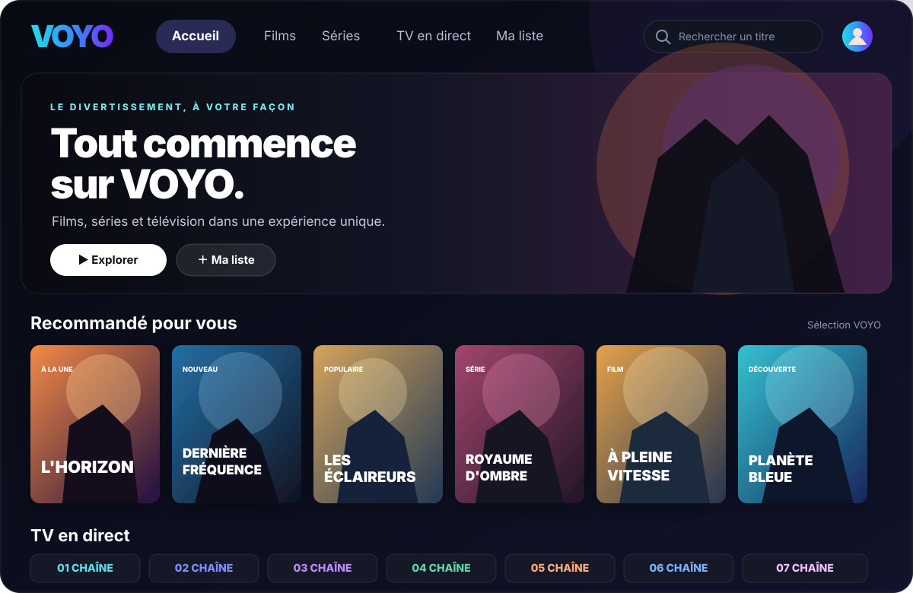

<p align="center">
  
</p>

<h1 align="center">VOYO — Films, séries &amp; TV</h1>

<p align="center">
  <strong>Une interface de streaming responsive avec des catalogues connectés par addons.</strong><br>
  Projet web indépendant avec identité visuelle VOYO et navigation pensée pour ordinateur et mobile.
</p>

<p align="center">
  <a href="https://mansstyle59.github.io/voyo-streaming/"><strong>▶ Ouvrir VOYO</strong></a>
  &nbsp;·&nbsp;
  <a href="https://mansstyle59.github.io/voyo-streaming/addons.html"><strong>🧩 Gestion des addons</strong></a>
  &nbsp;·&nbsp;
  <a href="https://github.com/mansstyle59/voyo-streaming/actions"><strong>Tests &amp; déploiement</strong></a>
</p>

---

## Aperçus

### Ordinateur

<p align="center">
  
</p>

### Mobile

<p align="center">
  
</p>

<sub>Les visuels sont des maquettes d’illustration, pas des captures d’écran réelles de la dernière version publiée.</sub>

---

## Fonctions de la démo

- **Catalogue réel dynamique** : films et séries récupérés depuis les catalogues Cinemeta, avec affiches et fiches réelles ; les contenus fictifs ne sont plus affichés comme s’ils étaient réels.
- **Accueil cinéma** : grande sélection à la une, rangées horizontales, Top 10, nouveautés et genres construits à partir des titres chargés.
- **Interface cinéma premium** : contrastes renforcés, dégradés plus subtils, profondeur visuelle, cartes affinées, états de survol et navigation au clavier plus visibles.
- **Responsive mobile retravaillé** : barre supérieure compacte, affiche à la une mieux hiérarchisée, boutons plus faciles à toucher et rangées horizontales adaptées aux petits écrans.
- **Menu mobile** : navigation flottante en bas de l’écran, recherche, bibliothèque et profil.
- **Reprendre à regarder** : progression d’exemple pour illustrer l’interface.
- **Recherche locale** : recherche dans les titres et descriptions de démonstration.
- **Recherche d’addons** : si un addon expose un catalogue de recherche compatible, VOYO transmet le terme saisi via l’option `search`.
- **Catalogues externes sur l’accueil** : tentative de chargement des catalogues des addons actifs et affichage des titres renvoyés.
- **Fiches externes** : VOYO peut interroger `meta` pour récupérer description, détails et épisodes lorsqu’ils sont fournis.
- **Sources** : l’application ne recherche des flux que si le manifeste annonce une ressource `stream`; la lecture dépend ensuite du format et du navigateur.
- **Ma liste et préférences** : fonctions de démonstration stockées localement dans le navigateur.
- **Gestion des addons** : ajout par URL de manifeste, vérification, activer/désactiver, supprimer, importer/exporter JSON et explorer les catalogues.
- **Tests automatiques** via GitHub Actions : contrôle de syntaxe JavaScript, tests de parcours simulé et diagnostic réseau non bloquant du manifeste configuré.
- **Publication statique** par GitHub Pages.

## Gestion des addons Stremio

**[Ouvrir la page Addons](https://mansstyle59.github.io/voyo-streaming/addons.html)**

VOYO utilise le protocole HTTP des addons distants Stremio, de manière expérimentale :

| Ressource | Usage |
|---|---|
| `manifest.json` | Lire l’identité, les ressources et les catalogues déclarés. |
| `catalog` | Charger les titres d’un catalogue pour créer des rangées de cartes. |
| `meta` | Charger les détails d’un titre et les épisodes lorsque l’addon les expose. |
| `stream` | Demander des sources uniquement si cette ressource est déclarée par l’addon. |

### Manifeste public configuré

L’application préconfigure l’URL publique du service :

`https://addon-stremio-fs-public.stremio-fs-public.workers.dev/manifest.json`

Cette URL racine est utilisée dans le dépôt pour éviter d’exposer dans le code public un lien de configuration qui pourrait contenir des paramètres privés. Le diagnostic lancé par GitHub Actions a confirmé que le manifeste répond en HTTP 200, avec `Access-Control-Allow-Origin: *`, et qu’il déclare les ressources `catalog` et `meta`.

Plusieurs catalogues ont renvoyé des titres lors du diagnostic, notamment **FS - Films Action**, **FS - Dernières Séries** et des rangées de séries. Les catalogues de recherche n’ont pas de résultats tant qu’aucun terme n’est transmis ; la barre de recherche VOYO transmet désormais le terme saisi aux catalogues qui correspondent à une recherche.

**Limite importante :** le manifeste public testé n’annonce pas la ressource `stream`. Il peut donc exposer des catalogues et des fiches mais ne fournit pas directement de flux vidéo par le protocole Stremio dans cette configuration. L’interface n’invente pas de lien de lecture lorsque le service ne fournit pas de flux.

### Limites techniques

- Certains addons peuvent renvoyer des réponses lentes ; les catalogues sont chargés en parallèle avec un délai par requête.
- Les paramètres `extra`, les identifiants d’épisodes et les formes de réponse peuvent varier d’un addon à l’autre.
- Le navigateur doit pouvoir interroger le service tiers (CORS et accès réseau).
- HLS, DASH, torrents, DRM, flux avec en-têtes particuliers et formats natifs peuvent demander un lecteur ou un backend spécifique.
- Les addons qui exécutent du code local ne sont pas lancés par cette application statique.
- La liste et les préférences sont locales au navigateur ; il n’y a pas encore de comptes sécurisés ni de synchronisation entre appareils.

Ajoute uniquement des addons de confiance et des contenus ou flux que tu es autorisé à consulter ou diffuser.

## Essayer VOYO

- [Application](https://mansstyle59.github.io/voyo-streaming/)
- [Gestion des addons](https://mansstyle59.github.io/voyo-streaming/addons.html)
- [Tests et déploiements](https://github.com/mansstyle59/voyo-streaming/actions)
- [Code source](https://github.com/mansstyle59/voyo-streaming)

Pour le développement local, clone le dépôt et sers les fichiers avec un serveur local ou HTTPS : certains navigateurs limitent les appels réseau depuis des pages ouvertes directement en fichier.

## Structure du dépôt

```text
voyo-streaming/
├── .github/
│   └── workflows/
│       └── deploy.yml
├── assets/
│   ├── voyo-desktop-preview.svg
│   └── voyo-mobile-preview.svg
├── tests/
│   └── smoke.mjs
├── index.html
├── addons.html
└── README.md
```

## Vérification et publication

Le workflow `.github/workflows/deploy.yml` est lancé lors des modifications sur `main`. Il :

1. extrait le JavaScript de `index.html` et `addons.html`, puis vérifie la syntaxe avec Node ;
2. installe une dépendance de test et exécute `tests/smoke.mjs`, qui simule les réponses d’un addon pour tester l’accueil, les catalogues, les détails, la recherche de flux et les erreurs de manifeste ;
3. teste le manifeste public et plusieurs catalogues à titre de diagnostic. Ce contrôle réseau est informatif et ne bloque pas le déploiement en cas de problème côté service tiers ;
4. publie les fichiers statiques par GitHub Pages si les contrôles bloquants réussissent.

- [Dernières exécutions](https://github.com/mansstyle59/voyo-streaming/actions)
- [Paramètres GitHub Pages](https://github.com/mansstyle59/voyo-streaming/settings/pages)

## Suite du développement

1. Améliorer les options avancées de recherche et les paramètres spécifiques d’addons.
2. Ajouter un lecteur plus complet pour les formats pris en charge et les sous-titres externes.
3. Tester davantage d’addons et de réponses d’épisodes sur des appareils réels, notamment Safari iOS.
4. Étudier un backend optionnel pour les addons qui ne supportent pas CORS.
5. Ajouter de vrais comptes, le contrôle parental et la synchronisation sécurisée entre appareils.

## Projet indépendant

VOYO est en développement et n’est affilié ni à Netflix, ni à Stremio, ni à Nuvio. Les métadonnées des films et séries sont chargées depuis Cinemeta, service tiers de métadonnées compatible avec l’écosystème Stremio. VOYO n’héberge pas ces contenus et ne fournit pas automatiquement les droits de diffusion ni les flux vidéo. Les options de lecture doivent venir de sources autorisées.

---

<p align="center"><strong>VOYO</strong> · Projet indépendant en développement</p>
